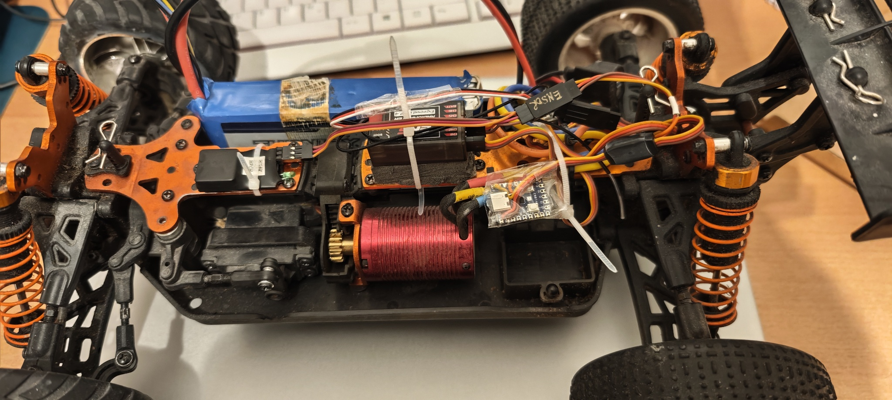
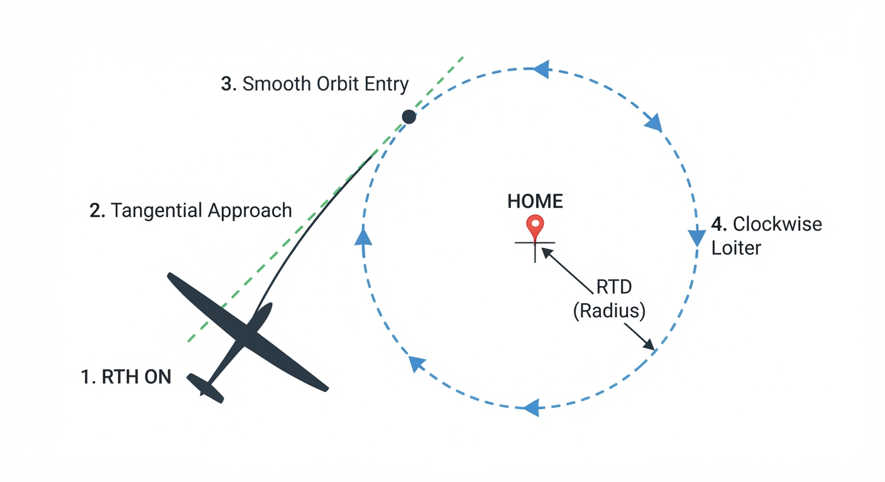

# Kostengünstiges Return to Home (RTH) für openXsensor (RP2040)

> **[English Version available here (README_ENG.md)](README_ENG.md)**

Ein einfaches, **kostengünstiges Return-to-Home (RTH) System** auf Basis des **Raspberry Pi RP2040** und **openXsensor (oXs)**. Es bringt dein Flugmodell auf Knopfdruck sicher zum Startpunkt zurück und lässt es dort zuverlässig kreisen – ganz ohne komplizierten Flight Controller.

> **Zentraler Quellcode:**  
> Den vollständigen Programmcode für dieses Projekt findest du im Haupt-Repository:  
> **[Networker-001/oXs_on_RP2040-add-ons](https://github.com/Networker-001/oXs_on_RP2040-add-ons)**
> 
> Die `FrSky_2_CRSF.uf2` Datei für dieses Projekt findest du im Config-Ordner:  
> **[Networker-001/oXs_on_RP2040-add-ons/Config](https://github.com/Networker-001/oXs_on_RP2040-add-ons/Config)**
---

## Das Grundprinzip: Einfach, sicher und günstig

Im Gegensatz zu ausgewachsenen Autopiloten (wie INAV oder ArduPilot) bleibt dieses RTH-System bewusst überschaubar und transparent:

* **Kostengünstige Hardware:** Ein kleiner RP2040-Mikrocontroller (z. B. RP2040-Zero für wenige Euro) und ein einfaches GPS-Modul genügen.
* **Stabilisierung erforderlich:** Das System benötigt eine grundlegende Fluglagestabilisierung – entweder über den **optionalen MPU6050-Gyro** von oXs oder über einen **stabilisierten Empfänger** (z. B. FrSky S6R/S8R, Jeti Assist, Lemon RX etc.).
* **Die Hauptsteuerung bleibt im Sender:** oXs greift **nicht** direkt in die Servos ein. Stattdessen sendet oXs lediglich eine Lenkempfehlung per Telemetrie (`GPS BEARING` / `YAW`) an den Sender. Alle Mischer, Servowege und der jederzeitige manuelle Eingriff über die Steuerknüppel bleiben sicher im Sender.
* **Mischung von Seitenruder und Querruder:** Im Sender wird das RTH-Signal sanft auf das **Seitenruder** (und leicht auf das **Querruder** zur Unterstützung der Kurvenlage) gemischt, während der Stabi das Modell sauber in der Waage hält.
* **Gefahrlos mit einem RC-Car erprobbar:** Da die Kursberechnung am Boden exakt genauso funktioniert wie in der Luft, kannst du die gesamte Technik vor dem Erstflug auf einem **einfachen RC-Car** montieren und Wirkrichtung sowie Kreisradius in Ruhe auf der Wiese oder dem Parkplatz testen.

---

## Hardware-Aufbau & Testträger


*Typischer Aufbau: RP2040-Zero, GPS-Modul.*


*Gefahrloser Bodentest: Überprüfung von Kreisradius und Lenkrichtung auf einem RC-Car.*

---

## So funktioniert der Rückflug in der Praxis


*Das Modell steuert den Zielkreis tangential an und geht ohne Überschwingen in einen Rechtskreis über.*

1. **Automatischer Home-Punkt (Anzeige im Feld `Sats`):** Nach dem Einschalten prüft oXs den GPS-Empfang und zeigt den Status direkt durch einen Offset im Telemetriefeld **`Sats`** an:
   * **Unter `50`:** Noch kein stabiler 3D-Fix.
   * **Ab `50` (`50` + Satellitenanzahl, z. B. `58`):** Stabiler GPS-Fix erkannt – der 9-Sekunden-Countdown zum Speichern läuft.
   * **Ab `100` (`100` + Satellitenanzahl, ab `106`):** Nach 9 Sekunden stabilem Empfang ist der Startpunkt als **Home-Position** gespeichert und RTH ist startklar.
2. **RTH aktivieren:** Legst du im Flug den RTH-Schalter am Sender um, berechnet oXs den optimalen Kurs zurück zu einem virtuellen Kreis um deinen Standort.
3. **Anflug und Kreisen:** Das Modell dreht auf die Kreisbahn ein, fliegt geradlinig darauf zu und geht weich in einen **kontinuierlichen Rechtskreis** über dem Startpunkt über – so lange, bis du RTH wieder ausschaltest oder selbst steuerst.

---

## Vorkonfigurierte Firmware & Anpassung

Die hier bereitgestellten Firmware-Dateien sind bereits nach dem jeweiligen Empfängerprotokoll vorkonfiguriert (z. B. **`RTH_CRSF.uf2`** für ELRS / CRSF), sodass du ohne eigenes Kompilieren sofort starten kannst. GPIO 16 bleibt dabei frei für die interne RGB-LED des RP2040-Zero.

### Werkseitige Standard-Belegung (Beispiel `RTH_CRSF.uf2`)

| Funktion | Code-Definition (`config.h`) | RP2040 GPIO-Pin / Wert | Terminal-Befehl |
| :--- | :--- | :--- | :--- |
| **Telemetrie-Ausgang (TLM)** | `_pinTlm 0X00` | **GPIO 0** | `TLM=0` |
| **GPS TX (vom RP2040 zum GPS RX)** | `_pinGpsTx 0X1C` | **GPIO 28** | `GPS_TX=28` |
| **GPS RX (vom GPS TX zum RP2040)** | `_pinGpsRx 0X1D` | **GPIO 29** | `GPS_RX=29` |
| **Empfänger-Protokoll** | `_protocol 'C'` | **ELRS / CRSF** | `PROTOCOL=C` |
| **Ziel-Kreisradius (RTD)** | `_rth_radius 60` *(Standard)* | **60 m** | `RTD=60` |
| **Mindestgeschwindigkeit (RTS)** | `_rth_min_speed 5` *(Standard)* | **5 km/h** | `RTS=5` |
| **Primärer RC-Eingang (PRI)** | `_pinPrimIn 0XFF` | Deaktiviert | `PRI=255` |
| **INAV LTM Eingang / Konverter** | `_inav_ltm 0X00` | Deaktiviert | `CONV=0` |

---

## Komplette Konfiguration am PC (USB-Terminal)

Für Anpassungen über USB empfiehlt sich das kostenlose und einsteigerfreundliche Programm **[CoolTerm](https://the-meiers.org)** (verfügbar für Windows, macOS und Linux). Es erfordert keine Installation und ermöglicht das bequeme Einfügen von Befehlen per Kopieren und Einfügen.

### Kurzanleitung für CoolTerm
1. Verbinde den RP2040 per USB-Kabel mit dem PC und starte **CoolTerm**.
2. Klicke auf **Options**, wähle unter *Serial Port* den passenden COM-Port mit **`115200` Baud** (`8-N-1`) aus.
3. Wechsle links im Menü auf **Terminal** und stelle *Enter Key Emulation* auf **`CR+LF`** (wichtig, damit oXs die Befehle erkennt).
4. Klicke auf **OK** und danach oben auf **Connect**. Drücke einmal **Enter**, um die aktuelle Konfiguration anzuzeigen.

### Übersicht aller relevanten Konfigurationsbefehle

Bestehende Werte lassen sich jederzeit anpassen und mehrere Befehle mit `;` kombinieren:

| Befehl | Bedeutung | Empfehlung / Hinweise |
| :--- | :--- | :--- |
| `PROTOCOL=<Typ>` | Empfänger-Protokoll | `C` = ELRS/CRSF (Standard), `S` = FrSky S.Port, `F` = FrSky FBus, `J` = Jeti Ex, `H` = HoTT |
| `TLM=<Pin>` | Telemetrie-Pin zum Empfänger | Standard: `0` (GPIO 0) |
| `PRI=<Pin>` | RC-Kanal-Eingang vom Empfänger | Nur nötig, wenn oXs auch Servos oder den internen Gyro steuern soll (sonst deaktiviert) |
| `GPS_TX=<Pin>` | TX-Pin zum GPS-Modul (an GPS RX) | Standard: `28` (GPIO 28) |
| `GPS_RX=<Pin>` | RX-Pin vom GPS-Modul (an GPS TX) | Standard: `29` (GPIO 29) |
| `RTD=<Meter>` | **Ziel-Kreisradius** um den Startpunkt | RC-Car (Test): `3`–`5` m \| Segler / Motormodell: `60`–`80` m |
| `RTS=<km/h>` | **Mindestgeschwindigkeit** für Lenkbefehle | RC-Car (Test): `1`–`3` km/h \| Segler / Motormodell: `3`–`12` km/h |
| `SAVE` | **Einstellungen dauerhaft speichern** | Nach `SAVE` den RP2040 einmal neu starten (Strom trennen / Reset) |

**Beispiel für eine Anpassung im Terminal (z. B. Segler mit 60 m Radius und 8 km/h Mindestgeschwindigkeit):**
```text
RTD=60; RTS=8; SAVE
```

---

## Firmware aufspielen

1. Lade die passende Firmware-Datei für dein System (z. B. **`RTH_CRSF.uf2`** für ELRS/CRSF) unter [`Config`](https://github.com/Networker-001/oXs_on_RP2040-add-ons/tree/main/Config) herunter.
2. Halte die **BOOT-Taste** auf dem RP2040-Board gedrückt, während du es per USB mit dem PC verbindest.
3. Kopiere die heruntergeladene `.uf2`-Datei einfach auf das neu erscheinende Laufwerk `RPI-RP2`.
4. Öffne **CoolTerm**, prüfe oder passe die Werte (wie `RTD` und `RTS`) an und speichere Änderungen mit `SAVE`.

---

## Beispiel: Einrichtung im Sender (EdgeTX / OpenTX)

oXs überträgt das Lenksignal über den Standard-Telemetriewert **`GPS Home Bearing` (`Bear`)** oder im Feld **`YAW` bei CRSF** im Bereich von `-180` bis `+180` (wobei **`0` genau Geradeaus / Neutral** entspricht). Parallel erfolgt die Übertragung im Sensor `YAW`.

### Schritt 1: Telemetriesignal zentrieren (Inputs)
Lege einen neuen Input an (z. B. `I:RTH`):
* **Quelle:** `YAW` (Telemetriesensor)
* **Gewichtung:** `100%`
* **Offset:** `0` *(auf exakt `0%` Knüppelmitte)*

### Schritt 2: Auf Seiten- und Querruder mischen (Mischer)
Füge in den Mischern für Seite und Quer jeweils eine Zeile hinzu, die über deinen **RTH-Schalter** aktiviert wird (Mischertyp: **Addieren**, damit deine Knüppel jederzeit Vorrang haben):
* **Seitenruder:** `I:RTH` mit **`25%` bis `40%` Gewichtung** als Startwert beim Segler *(für RC-Car-Tests am Boden: `30%`)*.
* **Querruder (optional):** `I:RTH` mit **`10%` bis `20%` Gewichtung** für eine saubere Kurvenneigung ohne Schieben.
* **Stabilisierung:** Stelle sicher, dass beim Einschalten von RTH gleichzeitig dein Stabi/Gyro aktiv ist.

> **Tipp zum Einfliegen:**  
> Lege die Mischer-Gewichtung für das Seitenruder beim ersten Testflug auf einen Drehgeber oder seitlichen Schieber (z. B. `S1` / `LS`). So kannst du im Flug stufenlos testen, ab welchem Ausschlag das Modell ruhig und ohne Aufschaukeln kreist, und den ermittelten Wert danach fest im Mischer eintragen.

> **Wichtiger Wirkrichtungstest vor dem Start:**  
> Warte, bis im Telemetriefeld **`Sats`** ein **Wert ab `106`** angezeigt wird (Home-Position nach 9 Sekunden gespeichert), und gehe ca. `15–20 m` vom Startpunkt weg. Gehe zügig vorwärts, lege den RTH-Schalter um und prüfe, ob das Seitenruder so ausschlägt, dass das Modell eine **Rechtskurve** zurück zum Startpunkt einleitet. Lenkt es in die falsche Richtung, drehe einfach das Vorzeichen (`+` / `-`) bei der Mischer-Gewichtung um.

---

### Optional: EdgeTX Farbdisplay-Widget (z. B. RadioMaster TX16S / TX18S)

Für EdgeTX-Sender mit Farbdisplay steht ein passendes **GPS Homer Widget** zur Verfügung, das die aktuelle Position, Flugrichtung und Entfernung zum Home-Punkt übersichtlich auf dem Sender-Bildschirm anzeigt:

* **Widget-Download & Anleitung:** **[EdgeTX GPS Homer Widget](https://github.com/Networker-001/Widgets/tree/main/EdgeTX/GPS%20Homer)**
