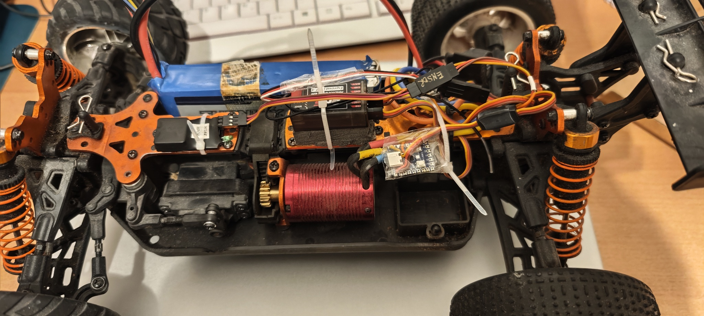
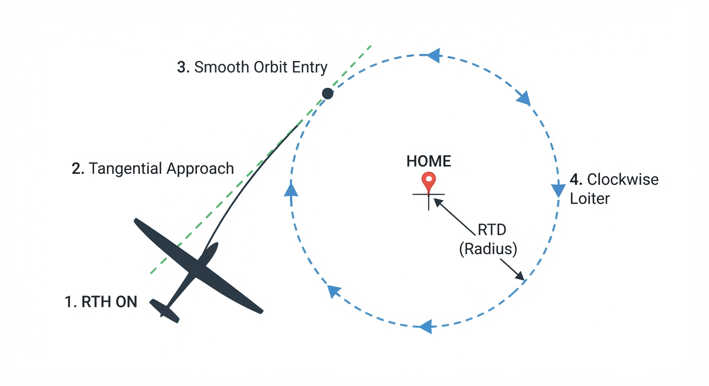

# Low-Cost Return to Home (RTH) for openXsensor (RP2040)

> **[Deutsche Anleitung hier lesen (README.md)](README.md)**

A simple, **low-cost Return-to-Home (RTH) system** based on the **Raspberry Pi RP2040** and **openXsensor (oXs)**. It brings your model airplane safely back to the starting point and lets it circle reliably overhead—without requiring a complex flight controller.

> **Source Code Repository:**  
> The full source code is maintained in the central project repository:  
> **[Networker-001/oXs_on_RP2040-add-ons](https://github.com/Networker-001/oXs_on_RP2040-add-ons)**

---

## The Core Idea: Simple, Safe & Affordable

Unlike full autopilots (such as INAV or ArduPilot), this RTH extension keeps things intentionally simple and transparent:

* **Low-Cost Hardware:** Built on a tiny RP2040 board (e.g., RP2040-Zero) paired with a standard GPS module and an optional MPU6050 gyro sensor.
* **Stabilization Required:** The system relies on basic flight stabilization (either using the built-in **MPU6050 gyro** of oXs or a **stabilized receiver**).
* **Full Control Stays in Your Transmitter:** oXs does **not** take over your servos directly. Instead, it sends a simple steering recommendation via telemetry (`HEADING`) to your radio. All mixing, limits, and manual stick overrides remain safely in your transmitter.
* **Rudder & Aileron Mixing for Clean Turns:** In your transmitter, the RTH signal is gently mixed onto **Rudder** (and lightly onto **Aileron** for coordinated turns) while the gyro keeps the wings level and maintains pitch.
* **Easy & Safe Testing with an RC Car:** Because the guidance logic works identically in 2D, you can mount the hardware on a **standard RC car** and test all settings, directions, and circle radii safely on the ground before your first flight.

---

## Hardware Setup & Test Platform


*Typical setup: RP2040-Zero, GPS module.*


*Safe ground testing: Verifying the RTH circle radius and steering direction on an RC car.*

---

## How It Works in Practice


*The model approaches the Home circle on a straight tangent line and smoothly enters a clockwise orbit.*

1. **Automatic Home Lock (`Sats` Telemetry Status):** After powering on, oXs monitors GPS reception and indicates the current lock status by adding an offset to the **`Sats`** telemetry field:
   * **Below `50`:** Waiting for a valid 3D GPS fix.
   * **`50` and above (`50` + satellite count, e.g., `58`):** Valid GPS fix acquired – the 9-second stability timer is running.
   * **`100` and above (`100` + satellite count, `106` or higher):** After 9 seconds of stable reception, the launch position is saved as the **Home point** and RTH is ready.
2. **Activating RTH:** When you flip the RTH switch on your transmitter, oXs calculates the exact course back to a virtual circle around your Home point.
3. **Smooth Approach & Orbit:** Your model turns toward the edge of the circle, flies straight toward it, and smoothly transitions into a **continuous clockwise orbit** around you until you switch RTH off or take over with the sticks.

---

## Pre-Configured Firmware & Customization

The provided pre-compiled firmware builds are named according to the pre-configured receiver protocol (e.g., **`RTH_CRSF.uf2`** for ELRS / CRSF), allowing you to get started immediately without compiling the code yourself. GPIO 16 remains free for the onboard RGB LED of the RP2040-Zero.

### Factory Default Pinout (Example: `RTH_CRSF.uf2`)

| Function | Code Definition (`config.h`) | RP2040 GPIO Pin | Terminal Command |
| :--- | :--- | :--- | :--- |
| **Telemetry Output (TLM)** | `_pinTlm 0X00` | **GPIO 0** | `TLM=0` |
| **GPS TX (RP2040 TX to GPS RX)** | `_pinGpsTx 0X0F` | **GPIO 15** | `GPS_TX=15` |
| **GPS RX (GPS TX to RP2040 RX)** | `_pinGpsRx 0X11` | **GPIO 17** | `GPS_RX=17` |
| **Receiver Protocol** | `_protocol 'C'` | **ELRS / CRSF** | `PROTOCOL=C` | — |

---

## Full Configuration via USB Terminal (CoolTerm)

For configuring the RP2040 via USB, we recommend the free, user-friendly serial terminal **[CoolTerm](https://the-meiers.org)** (available for Windows, macOS, and Linux). It requires no installation and makes copying and pasting configuration commands effortless.

### Quick Setup for CoolTerm
1. Connect the RP2040 to your PC via USB and open **CoolTerm**.
2. Click **Options**, select your COM port under *Serial Port*, and set the baud rate to **`115200`** (`8-N-1`).
3. Switch to the **Terminal** tab on the left and set *Enter Key Emulation* to **`CR+LF`** (required for oXs to recognize commands).
4. Click **OK**, then click **Connect**, and press **Enter** once to display the current configuration.

### Complete Reference of Relevant Commands

You can adjust existing settings at any time and separate multiple commands with `;`:

| Command | Meaning | Recommendation / Notes |
| :--- | :--- | :--- |
| `PROTOCOL=<Type>` | Receiver protocol | `C` = ELRS/CRSF (Default), `S` = FrSky S.Port, `F` = FrSky FBus, `J` = Jeti Ex, `H` = HoTT |
| `TLM=<Pin>` | Telemetry pin to receiver | Default: `0` (GPIO 0) |
| `PRI=<Pin>` | RC channel input from receiver | Only needed if oXs also drives servos or the onboard gyro (otherwise disabled) |
| `GPS_TX=<Pin>` | TX pin to GPS module (connect to GPS RX) | Default: `15` (GPIO 15) |
| `GPS_RX=<Pin>` | RX pin from GPS module (connect to GPS TX) | Default: `17` (GPIO 17) |
| `RTD=<meters>` | **Target Orbit Radius** around Home | RC Car (Test): `3`–`5` m \| Glider / Plane: `100`–`150` m |
| `RTS=<km/h>` | **Minimum Speed** for steering updates | RC Car (Test): `1`–`3` km/h \| Glider / Plane: `5`–`12` km/h |
| `SAVE` | **Save all settings permanently** | Power cycle or reset the RP2040 after sending `SAVE` |

**Example of a customization in the terminal (e.g., glider with 120 m radius and 8 km/h minimum speed):**
```text
RTD=120; RTS=8; SAVE
```

---

## Installing the Firmware

1. Download the matching firmware file for your radio protocol (e.g., **`RTH_CRSF.uf2`** for ELRS/CRSF) from the [config](https://github.com/Networker-001/oXs_on_RP2040-add-ons/tree/main/config) page.
2. Hold the **BOOT** button on the RP2040 board while connecting it to your PC via USB.
3. Copy the downloaded `.uf2` file onto the `RPI-RP2` drive that appears.
4. Open **CoolTerm**, check or customize your parameters (such as `RTD` and `RTS`), and save changes with `SAVE`.

---

## Transmitter Setup (EdgeTX / OpenTX)

oXs transmits the steering command through the standard **`HEADING` (`Hdg`)** telemetry sensor (`0` to `100`, where **`50.0` is neutral / straight ahead**).

### Step 1: Center the Telemetry Signal (Input)
Create a new Input (e.g., `I:RTH`):
* **Source:** `Hdg` (Telemetry sensor)
* **Weight:** `100%`
* **Offset:** `-50%` *(Turns `50.0` neutral into exact `0%` stick center)*

### Step 2: Mix onto Rudder & Aileron (Mixer)
Add a mixer line controlled by your **RTH Switch** (using **Multiplex: Add** so your sticks always override the RTH):
* **Rudder Channel:** Add `I:RTH` with **`25%` to `40%` weight** as a safe starting value for gliders *(for RC car ground testing: `100%` to `200%`)*.
* **Aileron Channel (optional):** Add `I:RTH` with **`10%` to `20%` weight** to support smooth, coordinated banking into the turn.
* **Stabilization:** Make sure your gyro stabilization mode is active whenever RTH is switched on.

> **Tuning Tip for Maiden Flights:**  
> Assign the rudder mixer weight to a potentiometer or side slider (e.g., `S1` / `LS`) during your first test flights. This lets you smoothly dial in the ideal turn authority in the air without oscillation, and save the final percentage afterward.

> **Important Direction Check Before Takeoff:**  
> Wait until the **`Sats`** telemetry field shows a **value of `106` or higher** (Home point saved after 9 seconds), then walk about `15–20 m` away from your starting point. Walk forward at a brisk pace, flip the RTH switch, and check that the rudder deflects to steer the model in a **clockwise** turn back toward Home. If it steers the wrong way, simply invert the `+` / `-` sign of the mixer weight.

### Optional: EdgeTX Color Screen Widget (e.g., RadioMaster TX16S)

For EdgeTX transmitters equipped with a color display (such as the RadioMaster TX16S), a dedicated **GPS Homer Widget** is available to visualize your model's position, heading, and distance relative to the Home point directly on your radio screen:

* **Widget Download & Setup:** **[EdgeTX GPS Homer Widget (Networker-001/Widgets)](https://github.com/Networker-001/Widgets/tree/main/EdgeTX/GPS%20Homer)**


